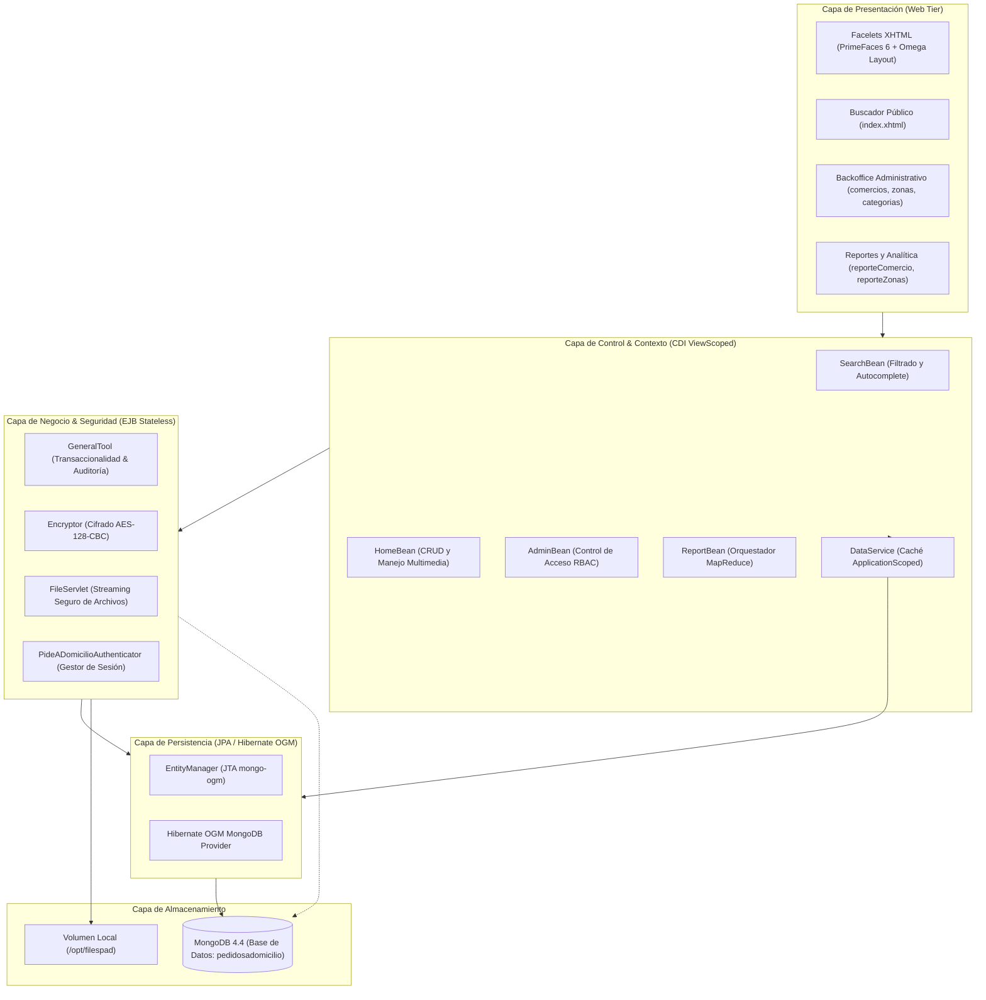
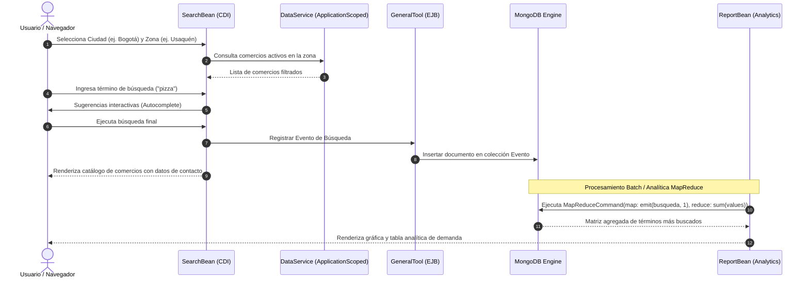

# 🛵 PideADomicilio: Java EE Enterprise Delivery Directory & Commerce Platform


Plataforma enterprise de comercio electrónico, directorio comercial y motor de búsqueda para pedidos a domicilio bajo demanda (*on-demand delivery*). Desarrollada sobre una arquitectura Java EE 7 desacoplada, integra presentación web reactiva con **JSF 2.2** y componentes **PrimeFaces** (tema responsivo Omega), inyección de dependencias **CDI**, servicios transaccionales **EJB**, y persistencia NoSQL orientada a documentos mediante **Hibernate OGM** (Object/Grid Mapper) sobre **MongoDB**, complementada con analítica distribuida vía **MapReduce**.

---

## 📌 Contexto del Proyecto & Dominio de Negocio

**PideADomicilio** fue concebida como una solución integral para digitalizar la oferta de restaurantes, droguerías, tiendas de licores y comercios de barrio en Colombia, ofreciendo a los usuarios una experiencia de búsqueda georreferenciada por ciudad y zona urbana con contacto directo a los comercios.

La plataforma resuelve tres desafíos arquitectónicos clave en plataformas de delivery:
1. **Modelado NoSQL con Semántica JPA:** Permite aprovechar la flexibilidad de documentos JSON en MongoDB (listas dinámicas de teléfonos, etiquetas de búsqueda, atributos variables por tipo de comercio) sin perder las garantías del estándar JPA (`@Entity`, `@ManyToOne`, `@ElementCollection`, `@OrderColumn`).
2. **Motor de Búsqueda y Auto-completado Multifactorial:** Permite a los clientes filtrar simultáneamente por ciudad, zona barrial, categoría gastronómica y términos libres, ordenando resultados por relevancia y peso comercial (`peso`).
3. **Analítica de Demanda con MongoDB MapReduce:** Agregación en tiempo real de consultas y términos más buscados para generar tableros de inteligencia de negocios para comerciantes y operadores.

---

## 🏗️ Arquitectura del Sistema

La solución implementa una arquitectura por capas en Java EE sobre el servidor de aplicaciones WildFly:



---

## 🔄 Flujo de Búsqueda y Analítica MapReduce



---

## 📊 Modelo de Datos (Colecciones MongoDB & Entidades JPA)

La persistencia se organiza en colecciones orientadas a documentos gestionadas por Hibernate OGM:

| Entidad | Colección | Descripción | Relaciones / Campos Clave |
| :--- | :--- | :--- | :--- |
| **`Comercio`** | `Comercio` | Establecimiento comercial o restaurante registrado en la plataforma. | `nombre`, `direccion`, `url`, `img`, `peso`, `@ManyToOne` `Zona`, `@ManyToOne` `Categoria`, `@ElementCollection` `telefonos`, `tags`. |
| **`Ciudad`** | `Ciudad` | Municipio o metrópoli de cobertura (Bogotá, Medellín, Cali, Ibagué). | `_id` (String clave natural), `nombre`. |
| **`Zona`** | `Zona` | Sector urbano o barrio de despacho dentro de una ciudad. | `_id` (`Nombre_Ciudad`), `nombre`, `@ManyToOne` `Ciudad`. |
| **`Categoria`** | `Categoria` | Rubro gastronómico o comercial (Hamburguesas, Pizza, Farmacia). | `_id` (String identificador), `nombre`. |
| **`Banner`** | `Banner` | Publicidad y piezas promocionales destacadas en portada. | `nombre`, `img`, `url`, `tipo`, `@ManyToOne` `Categoria`. |
| **`User`** | `User` | Credenciales y perfiles de acceso administrativo. | `username`, `password` (hash AES-128-CBC), `role` (`ADMIN`, `USUARIO`). |
| **`Evento`** | `Evento` | Trazabilidad de consultas y telemetría de búsqueda. | `tipo`, `fecha`, `busqueda`, `zona`, `categoria`. |

---

## 🔒 Mecanismos de Seguridad & Criptografía

El módulo `com.infinitec.pideadomicilio.tools.Encryptor` implementa cifrado simétrico robusto para la protección de contraseñas de usuarios administradores y operadores:

- **Algoritmo:** `AES/CBC/PKCS5PADDING` (Advanced Encryption Standard).
- **Longitud de Clave:** 128 bits con vector de inicialización (IV) de 16 bytes.
- **Codificación:** Salida y entrada en Base64 RFC 4648 compatible con Java 8 a Java 22.
- **Configuración Dinámica:** Posibilidad de sobreescribir claves e IV mediante variables de entorno `AES_SECRET_KEY` y `AES_INIT_VECTOR`.
- **Control de Acceso:** Filtro JAAS y bean de sesión `PideADomicilioAuthenticator` que restringe el acceso al backoffice administrativo (`comercios.xhtml`, `usuarios.xhtml`) exclusivamente a roles autorizados (`ADMIN`).

---

## 📈 Tablero de Inteligencia & Analítica MapReduce

El controlador `ReportBean` ejecuta funciones MapReduce nativas de MongoDB para consolidar estadísticas de demanda:

```javascript
// Función Map: clasifica cada registro de búsqueda individual
var map = function () {
    emit(this.busqueda, 1);
};

// Función Reduce: consolida las frecuencias totales por término
var reduce = function (key, values) {
    return Array.sum(values);
};
```

Reportes disponibles en el backoffice:
- **`reporteComercio.xhtml`:** Consultas por nombre de comercio y términos asociados.
- **`reporteCategorias.xhtml`:** Análisis de volumen por categoría gastronómica.
- **`reporteZonas.xhtml`:** Identificación de barrios y sectores urbanos con mayor actividad de pedidos.

---

## 🚀 Despliegue con Docker Compose

La plataforma incluye una orquestación multi-contenedor lista para producción local:

```bash
# 1. Clonar el repositorio
git clone https://github.com/KevinAndrey96/java-ee-pideadomicilio-delivery-directory-platform.git
cd java-ee-pideadomicilio-delivery-directory-platform

# 2. Configurar variables de entorno (opcional)
cp .env.example .env

# 3. Construir e iniciar los servicios
docker compose up -d --build
```

### Servicios Expuestos

| Servicio | Contenedor | Puerto Local | Descripción |
| :--- | :--- | :---: | :--- |
| **Web Application** | `pideadomicilio-web` | `http://localhost:8080/` | Portal web JSF PrimeFaces y API de archivos. |
| **WildFly Management** | `pideadomicilio-web` | `http://localhost:9990/` | Consola administrativa del servidor de aplicaciones. |
| **MongoDB Datastore** | `pideadomicilio-mongo` | `localhost:27017` | Base de datos NoSQL con colecciones pre-sembradas. |
| **Mongo Express UI** | `pideadomicilio-mongo-express` | `http://localhost:8081/` | Interfaz gráfica web para inspeccionar MongoDB. |

### Credenciales de Acceso por Defecto

- **Backoffice PideADomicilio:** Usuario `ADMIN` | Contraseña `admin123`
- **Mongo Express:** Usuario `admin` | Contraseña `admin`

---

## 🧪 Suite de Pruebas & Verificación Automatizada

La plataforma cuenta con una suite integral de verificación arquitectónica en Python (`scripts/verify_pideadomicilio.py`) y pruebas unitarias JUnit:

```bash
# Ejecutar suite de verificación de arquitectura
python3 scripts/verify_pideadomicilio.py
```

Resultados de la verificación:
- **Test 1:** Integridad de código fuente y paquetes (27 clases Java).
- **Test 2:** Validación sintáctica de descriptores XML (`pom.xml`, `web.xml`, `persistence.xml`, `faces-config.xml`).
- **Test 3:** Modelo de entidades JPA y relaciones de catálogo.
- **Test 4:** Verificación criptográfica con vectores deterministas AES-128-CBC.
- **Test 5:** Validación de lógica MapReduce y funciones de agregación.
- **Test 6:** Configuración y orquestación multi-contenedor Docker Compose.
- **Test 7:** Integridad de 22 vistas Facelets XHTML y plantillas Omega layout.

---

## 📄 Licencia

Este proyecto está distribuido bajo la Licencia MIT. Consulta el archivo `LICENSE` para más detalles.

---

## 👨‍💻 Autor

**Kevin Andrey Herrera Silva**  
Senior Backend Engineer & Software Architect  
Bogotá, Colombia  

- GitHub: [https://github.com/KevinAndrey96](https://github.com/KevinAndrey96)  
- LinkedIn: [https://www.linkedin.com/in/kevinandrey96/](https://www.linkedin.com/in/kevinandrey96/)
